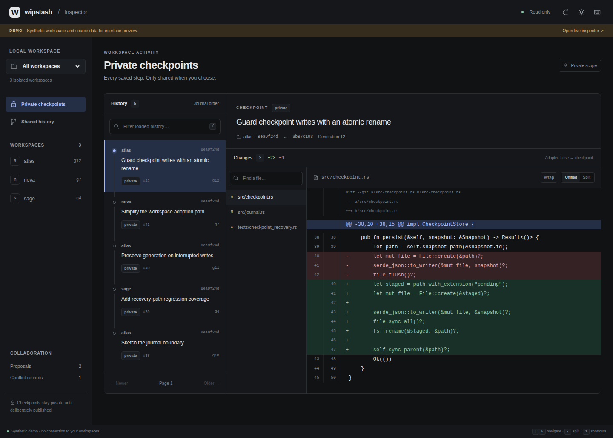

# Wipstash

### Commit the change. Keep working.

Wipstash gives each coding agent its own working directory. One commit saves the current source, submits it, and attempts integration into the shared project. Each agent chooses when to merge shared changes.

Several agents can edit one project concurrently in separate directories. Uncommitted edits remain local, and shared changes arrive in a directory only when its owner merges them.

**Edit → commit to shared. Merge shared changes when ready.**

Wipstash is a Rust prototype with a working local collaboration loop, a standalone `wip` CLI, and explicit source exchange between independent client and authority stores. Start with the disposable demo below. The operating profile remains cooperative; selected native Linux/macOS/Windows and real loopback TLS contracts have passed at the revisions recorded in the scope document. Broader platform, deployed network and remote backup acceptance remain open. [Exact scope and release gates →](docs/SCOPE.md)

## Inspect the work



*Actual Dioxus browser capture; synthetic demo data.*

**Wipstash Inspector** is a compact Dioxus web UI for understanding what happened without changing it. Browse shared commit outcomes, blocked conflicts and local recovery commits; select a file to inspect a unified or side-by-side diff.

- Real journal order and explicit comparison bases, rather than invented timestamps
- Workspace and loaded-history filters, keyboard navigation, dark/light themes and a responsive layout
- Lazy, bounded diffs with line numbers and clear binary/truncation notices
- A separate read-only service: browsing never recovery records, publishes, integrates, merges or recovers your state

Build and launch it against an **existing** Wipstash state directory:

```sh
rustup target add wasm32-unknown-unknown
cargo install wasm-bindgen-cli --version 0.2.129 --locked
python3 apps/inspector/scripts/build.py
cargo run --locked --manifest-path services/inspector/Cargo.toml -- \
  --state /absolute/path/to/state \
  --assets apps/inspector/dist
```

Open **http://127.0.0.1:47831**. This is a local operator tool that can show private recovery record source. Keep it on your own trusted machine; do not port-forward it or expose it through a remote proxy. It has no remote login or mutation routes.

[Interface and shortcuts](apps/inspector/README.md) · [Read-only API and security boundary](services/inspector/README.md) · [Adversarial inspection tests](tests/INSPECTOR-SECURITY-REVIEW.md)

Cloud Run can also host the central authority with durable Cloud Storage checkpoints and signed HTTPS clients. Existing native hosting remains available. See [Cloud Run setup and operation](docs/CLOUD-RUN.md).

## The workflow

| Action | Result |
| --- | --- |
| **Edit** | Use native file tools in your own isolated working directory. |
| **Add** | Stage exact selected file contents. |
| **Commit** | Save and share the staged tree in one command. |
| **Merge** | Deliberately reconcile shared changes with your working files. |

`wip add` selects exact contents and `wip commit -m MESSAGE` saves and shares them. Check `shared: true` before reporting sharing. Conflicts return a prepared review; offline or interrupted work remains durable for the next connected command or `wip sync`. There is no required client daemon, source-control MCP registration or agent launcher.

Successive commits track your last shared commit, so you can commit often without merging between commits. A commit does not rewrite any agent's working directory. Use Get Latest to inspect incoming paths and Commit messages, then Merge when ready. Recovery commits are implementation records, not another user workflow.

Checks are **off by default**. Commit shares conflict-free work immediately and the server runs configured checks asynchronously on immutable shared code, outside the repo lock. A shared commit can have pending or failed validation. Failures are offered to the next active workspace for 30 seconds; acknowledgement holds one exclusive repair lease. The originating commit remains separate evidence. Task/repair comments support targeted tips. other agents can inspect repo health and repair history. No configured checks means `unchecked`. Deployment eligibility requires passing checks for the exact version under the current policy. See [background validation](docs/BACKGROUND-VALIDATION.md).

Read [concurrent-agent status, conflict review, task claims and workspace lifecycle](docs/AGENT-COLLABORATION.md) and [dated validation results](docs/AGENT-FEEDBACK-VALIDATION.md). Server-confirmed advisory claims expose overlap before editing; all conflict types have prepared base/local/shared/result review directories.

## Try it

Requirements: Rust/Cargo and Git with `merge-tree --write-tree`. The toolchain is pinned in [rust-toolchain.toml](rust-toolchain.toml). Python is only needed for optional native-history collection and test harnesses.

```sh
cargo build --release --locked --bin wip
# Install target/release/wip on PATH, then:
wip init my-project
wip clone ./my-project ./alice
wip clone ./my-project ./bob
cd alice
# Create or edit apa.js.
wip add apa.js
wip diff --staged
wip commit -m 'tjenis tjenis'
```

Start any coding agent normally inside its own clone. For an existing remote, import the provisioned private device profile with `wip remote add NAME --config FILE`, then use `wip clone NAME DIRECTORY`. See [CLI setup, commands and migration](docs/CLIENTS.md).

`wip get-latest` fetches incoming work without editing files; `wip merge` deliberately brings it into your clone. Checks run on the server asynchronously. `wip status`, `wip diff`, `wip log` and `wip check` expose source and validation state. All commands support `--json` and predictable exit statuses.

Init makes the eligible imported tree the initial shared head; review source first. Credentials and engine state stay outside working directories. Protected `.wip` metadata is excluded from source. Native writers remain cooperative. [Operational contract →](docs/OPERATIONS.md)

## Four bots, one project

Imagine one bot changing an API, one updating its caller, one writing tests, and one fixing docs:

1. Each edits its own ordinary directory. Even two sessions of the same client need separate workspace IDs and paths.
2. The API agent commits a coherent increment. One call captures, submits and attempts integration; later edits remain local.
3. If the caller agent's commit conflicts, it opens the returned isolated resolution workspace, reviews and fixes it, then commits that resolution with the captured head and complete conflict-path attestation. Original WIP stays intact. Unrelated changes can still land.
4. The test agent checks shared changes and merges when ready. An merge conflict leaves its live files unchanged and offers an explicit local reconciliation.
5. Everyone verifies the returned shared outcome and uses operation receipts after uncertain responses. No separate publication or integration request is needed.

[Install the agent skill](skills/wipstash-source-control/SKILL.md) for the exact commit, conflict and recovery procedure. [Conflict handback](docs/CONFLICTS.md) documents the bounded resolution contract.

The test harness exercises this with **four deterministic scripted actors**. A separate [six-arm native model-agent pilot](docs/REAL-AGENT-VALIDATION.md) at `c489e00` drained 45 integrated commits and 39 superseded predecessors with private WIP preserved. It exposed stale-head coordination costs; it did not establish saturation or an optimal publication size. The current feedback acceptance exercise also runs installed Codex, Claude Code, OpenCode and Pi against an isolated local fixture, verifying server-checked sharing and unchanged peer files. Arbitrary native-writer containment and deployed multi-host acceptance remain release gates. See [the reproducible procedure](docs/AGENT-COLLABORATION.md).

## Why Git underneath?

Git already provides content-addressed objects, immutable commits, trees, ancestry, and three-way merge. Wipstash uses those building blocks while exposing operations that match how agents work.

- **Private object stores** retain workspace recovery records.
- **Public-base ancestry** exports the selected commit without linking its private recovery record chain.
- **A shared integration head** records accepted combinations.
- **SQLite journals and generations** track operation identity, state transitions, and recovery.

Git remains the storage and merge foundation. Wipstash combines saving and sharing in one commit while keeping merge deliberate. Uncommitted files remain private; recovery history is retained internally.

## CLI and independent clients

`wip` provides repository discovery, exact staging, sharing, incoming changes, conflicts, task claims, comments, repairs, audit, workspace lifecycle and recovery. `wip request` exposes additional public operations; `wip admin` retains trusted policy, backup and recovery access. Exact mutation identities are retained before execution. `wip operation list`, `show` and `retry` support interrupted commands without recapturing newer source.

`wip remote setup`, `device invite`, `join`, `serve`, `status` and `doctor` retain guided native mTLS enrollment and operator hosting. They run explicitly; clients need no installed service. Private keys and one-time invitations retain their reviewed protection rules. [Enrollment and recovery](docs/PAIRING.md).

Source-control MCP and the agent launchers are retired. The server still runs integration, validation and configured backup work. Each agent edits its own clone using ordinary native tools and calls the same CLI. [Complete agent workflow](skills/wipstash-source-control/SKILL.md).

**Source exchange:** independent client stores export deliberate public commits; an authority imports and integrates them; clients import public heads and explicitly merge. The core currently exchanges bounded filesystem artifacts with separately trusted provenance. [Protocol and commands →](docs/SOURCE-SYNC.md)

**Receipts:** the authority can return a commit observation with its disposition, evidence category, identity, and revision. Clients distinguish local transport state from the latest received authority observation. A receipt does not install a head, merge source, or prove the authority is reachable right now. Raw worker output and private recovery record histories are excluded from receipt payloads.

## Where it stands

| Area | Current boundary |
| --- | --- |
| One-call shared commits and deliberate merge | Implemented and exercised with real CLI/Git/SQLite on Linux; cooperative writers required |
| Independent stores and receipts | Implemented explicit artifact exchange, ordered replay, object verification, and targeted commit observations |
| Standalone CLI | Exact staging, direct authenticated delivery, coordination, conflict review and recovery; source-control MCP and required client workers retired. Platform and deployment evidence is recorded separately |
| Conflict handback | Explicit isolated resolution checkout and one-call resolution commit; bounded attempts and stale-tip validation. See [workflow and evidence boundary](docs/CONFLICTS.md) |
| Checks and repair | Background checks on exact shared versions; one leased agent repair owner, durable notices and server timing records. No automatic model invocation |
| Public recovery | Version 2 preserves public commit message, ownership, queue order, operation identity and replay metadata; restored execution stays fenced until explicit operator activation. Private WIP is excluded |
| Authenticated transport | mTLS service/client implementation, certificate ACLs and resumable uploads; in-memory contracts plus commit-specific native-CI loopback pairing and real-TLS upload-fault evidence. Deployed multi-machine acceptance remains open |
| Storage | Conservative loose-object collection and storage admission; no automatic expiry of private recovery records or acknowledged uploads, no power-loss guarantee |
| Native platform and GitHub backup | Selected native process, Git-path, storage and resumable-transfer contracts run on Linux/macOS/Windows CI; asynchronous GitHub backup components exist. Full native merge, real remote credentials and fresh-host recovery remain gates |
| Supported deployment | Development/evaluation on Linux; production, native macOS/Windows, and multi-machine release gates remain open |

The full contracts, limits, and missing gates live in [SCOPE.md](docs/SCOPE.md), [STORAGE.md](docs/STORAGE.md), and [GAP-CLOSURE.md](docs/GAP-CLOSURE.md). Keep an independent backup of valuable original work.

## Test the promises

```sh
cargo test --locked
cargo fmt --check
cargo clippy --locked --all-targets -- -D warnings
python3 tests/adversarial.py
python3 tests/gap_closure.py
uv run --no-project python tests/cli.py
python3 tests/shared_commit.py
python3 tests/source_sync.py

# Standalone components are separate Cargo packages:
for component in crates/platform crates/repair-runner services/storage services/transport services/backup; do
  cargo test --locked --manifest-path "$component/Cargo.toml"
done
```

The current shared-commit suite probes one-call integration, concurrent agents, required checks, conflict and merge resolution, and crash/lost-response recovery. Lower-level suites also probe private ancestry isolation, concurrent commits, stale generations, conflict block, unchanged files before merge, explicit resolution, replay, and retained-state recovery. See the [test harness guide](tests/README.md) and [source-exchange review](docs/SOURCE-SYNC-REVIEW.md).

Record the tested revision and retain local test artifacts when reporting results; earlier passing runs do not certify later changes. [WAN simulation](docs/WAN-SIMULATION.md) tests delayed/faulted application messages; production networking needs its own evidence. No performance target or production-readiness claim follows from these fixtures.

## Next gates

- Real Codex and Claude workflows with a verified writer-coordination contract
- Complete native Linux/macOS/Windows IPC, merge and filesystem acceptance beyond the selected CI contracts
- Deployed TLS transport acceptance: certificate lifecycle, revocation, resumable transfer and multi-machine failure drills
- Real remote backup and a fresh-host restore drill with explicit recovery coverage
- Live confined model repair, conservative GC acceptance, storage-pressure and power-loss testing

Contributions that close a gate should include a reproducible test and a precise statement of what it proves. Start with [scope](docs/SCOPE.md), then the [operations reference](docs/OPERATIONS.md) or [source exchange](docs/SOURCE-SYNC.md).

## License

[MIT](LICENSE). Build on it. Keep the notice.

## Optional ChatGPT Work / dot events

See [the optional MCP Events connection](services/mcp-events/README.md) for direct GitHub identity, explicit project grants, identity-bound invitations and best-effort five-minute event delivery. This optional read-only event integration is separate from source control through `wip`. Real OAuth/domain and ChatGPT acceptance remain separate release gates.

Action evidence is stored centrally with acknowledged delivery and native collection for Codex, Claude Code, OpenCode and Pi. See [central action audit](docs/AUDIT.md) for coverage, operation and verification.
